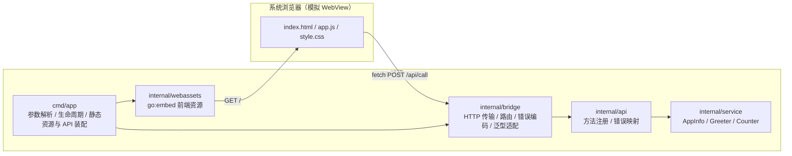

# test_go_wails 架构设计

> 状态：初稿  
> 日期：2026-11-15  
> 关联笔记：`langnote/2026/202611/20261115.md`

## 1. 背景与目标

笔记中确认了 [yetone/magpie](https://github.com/yetone/magpie) 的桌面端架构：**Go 后端 + Web 前端 + 系统 WebView（Wails v3）**，而不是用 Go 直接绘制原生控件。

本项目 `test_go_wails` 用**纯 Go、零第三方依赖**最小化复刻这套分层：保留「Go 业务能力 + Web UI + 前后端桥接」的核心结构，把不可移植的 WebView 外壳替换为**本机回环 HTTP + 系统浏览器**。这样可以在任意 CI 上编译和测试，不引入 CGO、GTK/WebKit、Node 工具链。

设计目标：

1. 结构上对齐 Wails：`cmd`（进程入口）、`internal/service`（Go 能力层）、`internal/bridge`（通信层）、`internal/webassets`（前端资源）。
2. 所有能力都通过统一的 JSON 调用协议暴露，前端不直接依赖 Go 类型。
3. 可在 Linux / macOS / Windows 的 GitHub Actions 上完成 vet、test、build。
4. 明确「哪里是模拟层、哪里可以替换成真实 Wails」，为后续迁移留出清晰边界。

非目标：

- 不实现真正的原生窗口、系统托盘、菜单、文件拖拽等 Wails 运行时能力。
- 不引入鉴权、多用户、持久化存储（当前定位是本机单用户演示）。
- 不追求生产级部署；服务只监听回环地址。

## 2. 架构总览



与 Wails v3 的映射关系：

| 本项目 | Wails v3 对应物 | 说明 |
| --- | --- | --- |
| `internal/bridge`（HTTP + JSON） | Wails bindings / runtime events | 传输方式不同，调用语义一致 |
| `internal/service` | 绑定到前端的 Go 服务对象 | 可直接迁移 |
| `internal/webassets` + 系统浏览器 | WebView + 内嵌前端资源 | 外壳不同 |
| `cmd/app` 生命周期管理 | Wails application 生命周期 | 可替换为 `application.New(...)` |

## 3. 分层与职责

### 3.1 入口层 `cmd/app`

- 解析命令行参数：`-addr`、`-no-open`、`-version`。
- 创建 `service.Service`，通过 `api.Register` 装配路由。
- 启动 `http.Server`，监听 `127.0.0.1:0`（随机端口，避免冲突）。
- 输出访问地址，按需调用系统默认浏览器打开页面。
- 监听 `SIGINT` / `SIGTERM`，执行带超时的优雅关闭。
- 注入构建信息（`version` / `commit` / `date`，通过 `-ldflags -X`）。

入口层**不包含业务逻辑**，只负责组装和进程生命周期。

### 3.2 通信层 `internal/bridge`

- 暴露 `POST /api/call` 与 `GET /api/health`。
- 请求体上限 1 MiB，拒绝未知字段之外的结构错误。
- 统一响应信封：成功返回 `data`，失败返回结构化 `error.code` + `error.message`。
- `Bind[P, R]` 泛型适配器：把 `func(ctx, P) (R, error)` 转成统一的 `Handler`，负责参数反序列化。
- `CodedError` 区分「调用方错误」（`invalid_json` / `invalid_params` / `method_not_found`）和「服务端错误」（`internal_error`）。
- 未知方法返回 404，参数错误返回 400，便于前端和测试区分。

该层只依赖标准库，不知道任何具体业务方法。

### 3.3 业务层 `internal/service`

- `Info()`：应用名、版本、Go 版本、OS/Arch、PID、启动时间、运行时长。
- `Greet(name)`：演示参数校验（去空格、长度上限、错误哨兵）。
- `Add(delta)` / `Reset()`：演示跨请求可变状态与并发保护（`sync.Mutex`）。

业务层不感知 HTTP、JSON 或前端；错误通过哨兵错误暴露，由 `internal/api` 映射为协议错误码。

### 3.4 资源层 `internal/webassets`

- 通过 `//go:embed` 将 `index.html`、`app.js`、`style.css` 编进二进制。
- 提供 `http.FileServer`，并追加 `Cache-Control: no-store`，避免开发时缓存旧页面。
- 二进制自包含：发布时无需附带静态目录。

## 4. 运行时模型

- **进程模型**：单进程，单 HTTP 监听器；无子进程、无守护线程池。
- **并发模型**：`net/http` 每请求一个 goroutine；`Counter` 用互斥锁保护共享状态。
- **生命周期**：启动 → 打印地址（可选打开浏览器）→ 等待信号 → 5 秒超时内 `Shutdown` → 退出码 0；启动失败退出码 1。
- **端口策略**：默认 `127.0.0.1:0` 由内核分配空闲端口，避免固定端口冲突；需要固定地址时用 `-addr 127.0.0.1:34115`。

## 5. 通信协议

请求：

```json
{ "method": "greeter.greet", "params": { "name": "Wails" } }
```

成功：

```json
{ "ok": true, "data": { "message": "你好，Wails！这条消息来自 Go 后端。", "at": "2026-11-15T00:00:00Z" } }
```

失败：

```json
{ "ok": false, "error": { "code": "invalid_params", "message": "name must not be empty" } }
```

方法命名采用 `领域.动作`，当前方法表：

| 方法 | 参数 | 返回 |
| --- | --- | --- |
| `app.info` | 无 | 应用与运行环境信息 |
| `greeter.greet` | `{ "name": string }` | `{ "message", "at" }` |
| `counter.add` | `{ "delta": number }` | `{ "value", "updatedAt" }` |
| `counter.reset` | 无 | `{ "value", "updatedAt" }` |

## 6. 安全设计

- 仅监听回环地址，不暴露到局域网；默认随机端口降低被探测概率。
- 请求体限流（1 MiB）、`ReadHeaderTimeout` 防慢速攻击。
- 前端与 API 同源，未开启 CORS。
- 当前无鉴权：定位本机演示。若未来改为 `0.0.0.0` 监听，必须增加一次性 token（启动时生成并注入页面/URL），并启用 Origin 校验。

## 7. 可观测性

- 标准库 `log/slog` 输出结构化文本日志到 stderr：请求方法、耗时、结果状态。
- 启动日志包含版本、监听地址；关闭日志包含退出原因。
- 构建信息可通过 `test_go_wails -version` 查看。

## 8. 构建与 CI

- `go vet ./...`、`go test -race ./...`、`go build ./cmd/app` 三步验证。
- GitHub Actions 矩阵：`ubuntu-latest`、`windows-latest`、`macos-latest`，三方编译产物作为 artifact 上传。
- 零第三方依赖，无需缓存私有模块；CI 只依赖 `actions/checkout`、`actions/setup-go`、`actions/upload-artifact`。

## 9. 演进路线

1. **接入真实 Wails v3**：新增 `cmd/desktop`，用 `application.New` 创建窗口，将 `internal/api` 的方法注册改为 Wails 服务绑定；`internal/bridge` 可保留作为调试用 HTTP 通道。
2. **事件推送**：为 bridge 增加 SSE/WebSocket 通道，对齐 Wails 的 `Events.Emit`。
3. **持久化**：在 service 层引入存储接口，默认文件/SQLite，测试使用内存实现。
4. **安全增强**：一次性 token、Origin 白名单、可配置监听地址。

## 10. 关键决策记录

| 决策 | 备选 | 理由 |
| --- | --- | --- |
| 纯 Go + 回环 HTTP 模拟 WebView 外壳 | 直接引入 Wails v3 | Wails 依赖 CGO/WebKit/Node，beta 版本在 CI 上构建不稳定；先用零依赖结构验证分层 |
| JSON 信封协议 | gRPC / JSON-RPC 2.0 | 结构简单，浏览器可直接用 `fetch`，便于手工调试 |
| 泛型 Handler 适配 | 反射注册 | 类型安全、错误在编译期暴露、代码可读 |
| 业务错误与协议错误分离 | service 直接返回 HTTP 错误码 | 保持业务层与传输层解耦 |
