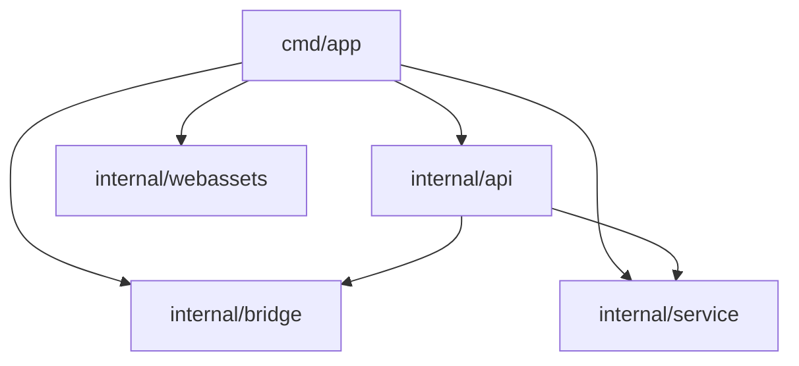
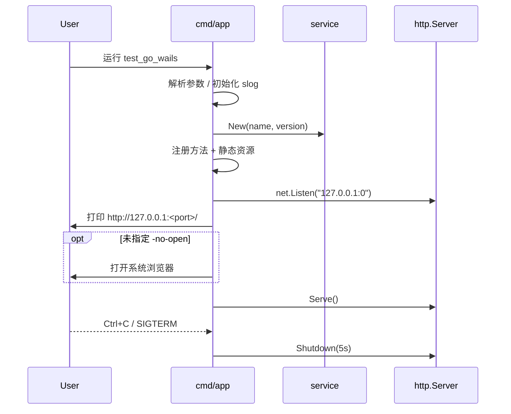
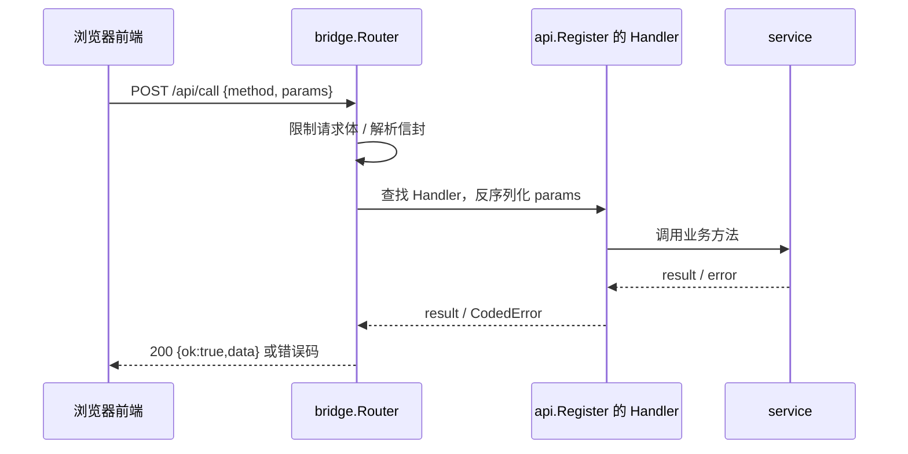

# test_go_wails 概要设计

> 状态：初稿  
> 日期：2026-11-15  
> 关联文档：[架构设计](./architecture.md)

## 1. 项目结构

```text
test_go_wails/
├── cmd/app/main.go                  # 进程入口：参数、服务装配、生命周期
├── internal/api/api.go              # 方法注册与错误映射
├── internal/api/api_test.go         # HTTP 层集成测试
├── internal/bridge/bridge.go        # 路由、协议、CodedError、泛型适配
├── internal/bridge/bridge_test.go   # 协议与路由测试
├── internal/service/service.go      # 业务能力：Info / Greet / Counter
├── internal/service/service_test.go # 业务规则测试
├── internal/webassets/              # 内嵌前端资源
│   ├── embed.go
│   ├── index.html
│   ├── app.js
│   └── style.css
├── docs/
│   ├── architecture.md
│   └── high-level-design.md
├── .github/workflows/ci.yml         # 三平台 CI
├── go.mod
└── README.md
```

## 2. 模块职责与依赖方向



依赖只允许指向内部：`cmd` → `api` → (`bridge`, `service`)。`bridge` 与 `service` 互不依赖，保证通信层和业务层可以独立演进、独立测试。

## 3. 接口定义

### 3.1 HTTP 接口

| 方法与路径 | 用途 | 成功状态 | 失败状态 |
| --- | --- | --- | --- |
| `GET /api/health` | 健康检查 | 200 | — |
| `POST /api/call` | 统一方法调用 | 200 | 400 / 404 / 500 |
| `GET /`、`GET /app.js`、`GET /style.css` | 前端资源 | 200 | 404 |

响应信封：

```go
type response struct {
    OK    bool      `json:"ok"`
    Data  any       `json:"data,omitempty"`
    Error *apiError `json:"error,omitempty"`
}

type apiError struct {
    Code    string `json:"code"`
    Message string `json:"message"`
}
```

错误码：

| 错误码 | HTTP 状态 | 触发条件 |
| --- | --- | --- |
| `invalid_json` | 400 | 请求体为空、非法 JSON、超过 1 MiB |
| `invalid_params` | 400 | 参数反序列化失败或业务校验失败 |
| `method_not_found` | 404 | `method` 未注册 |
| `internal_error` | 500 | 业务层返回未知错误 |

### 3.2 方法契约

```text
app.info
  params: {}
  result: {
    name: string, version: string, goVersion: string,
    os: string, arch: string, pid: number,
    startedAt: string (RFC3339), uptimeSeconds: number
  }

greeter.greet
  params: { name: string }        // 去空格后 1..32 个字符
  result: { message: string, at: string (RFC3339) }

counter.add
  params: { delta: number }       // -1_000_000..1_000_000
  result: { value: number, updatedAt: string (RFC3339) }

counter.reset
  params: {}
  result: { value: number, updatedAt: string (RFC3339) }
```

## 4. 核心流程

### 4.1 启动



### 4.2 方法调用



## 5. 数据结构

```go
// internal/service
type Info struct {
    Name          string    `json:"name"`
    Version       string    `json:"version"`
    GoVersion     string    `json:"goVersion"`
    OS            string    `json:"os"`
    Arch          string    `json:"arch"`
    PID           int       `json:"pid"`
    StartedAt     time.Time `json:"startedAt"`
    UptimeSeconds int64     `json:"uptimeSeconds"`
}

type Greeting struct {
    Message string    `json:"message"`
    At      time.Time `json:"at"`
}

type CounterState struct {
    Value     int64     `json:"value"`
    UpdatedAt time.Time `json:"updatedAt"`
}
```

时间统一使用 UTC 的 RFC3339 输出，由前端按本地时区展示。

## 6. 错误处理与约束

- 方法注册时校验：方法名非空、不得重复注册，重复即 panic（属于编程错误，启动期暴露）。
- `console`/前端调用错误通过 `ok=false` 分支处理，前端将其转换为异常并写入页面日志区域。
- 业务校验规则：
  - `name` 去空格后不能为空，长度不超过 32 个 Unicode 字符。
  - `delta` 绝对值不超过 1,000,000，防止溢出和误操作。
- 服务端错误只向前端暴露稳定文案，不返回堆栈；详细原因写入服务端日志。

## 7. 测试策略

| 层级 | 测试内容 |
| --- | --- |
| `internal/service` | 问候语裁剪/长度校验、计数器加减与并发安全 |
| `internal/bridge` | 成功调用、未知方法、非法 JSON、参数错误、CodedError 状态码、请求体超限 |
| `internal/api` | 通过 `httptest` 走完整 HTTP 栈，验证方法注册与错误映射 |
| CI | `go vet`、`go test -race`、三平台 `go build` |

## 8. 构建与发布

- 本地：`go run ./cmd/app`。
- 构建：`go build -trimpath -ldflags "-s -w -X main.version=<ver> -X main.commit=<sha>" -o bin/test_go_wails ./cmd/app`。
- CI：`.github/workflows/ci.yml` 在 push/PR 时执行三平台矩阵，上传编译产物 artifact。
- 发布（后续）：`v*` tag 触发 release，按平台命名归档；Windows 产物加 `.exe` 后缀。

## 9. 风险与后续

| 风险 | 影响 | 缓解 |
| --- | --- | --- |
| 浏览器外壳与真实 WebView 行为存在差异 | 不能验证 Wails 特有的窗口/菜单能力 | 明确其为模拟层；后续新增 `cmd/desktop` 接入 Wails v3 |
| 无鉴权 | 本机其他进程可调用 API | 只监听回环地址；扩展监听地址时强制 token + Origin 校验 |
| 内存状态不持久 | 重启后计数清零 | 后续在 service 后加存储接口 |
| Wails v3 仍是 beta | API 可能变化 | 业务层与 bridge 解耦，迁移只改入口与绑定层 |
